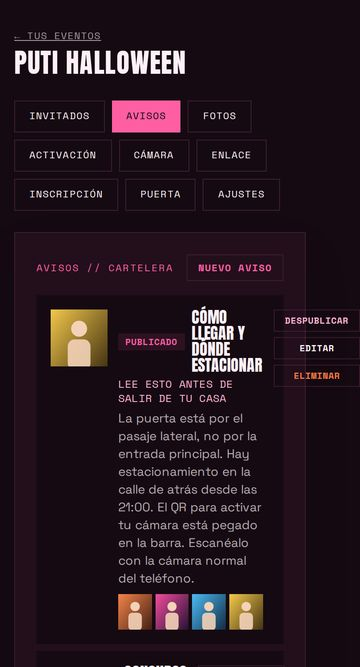
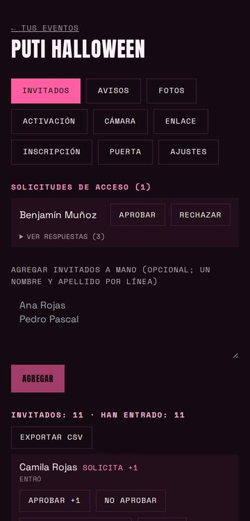
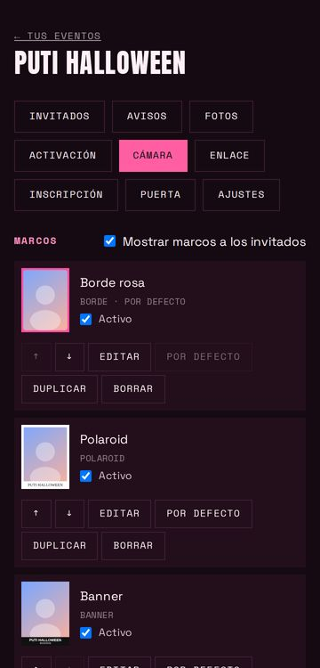
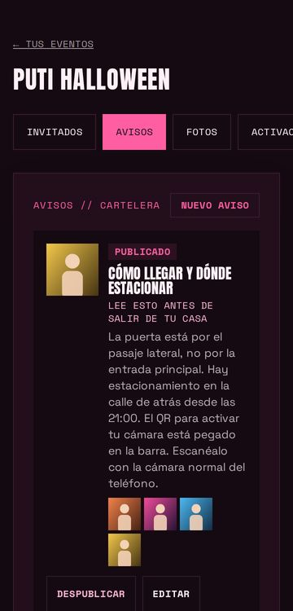
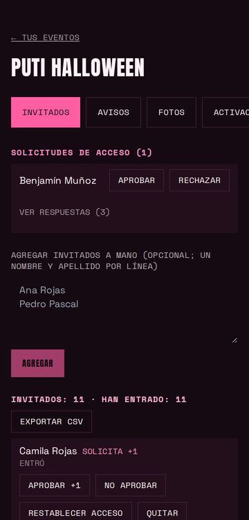
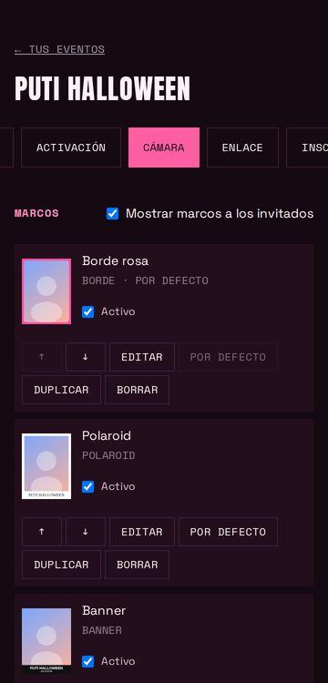
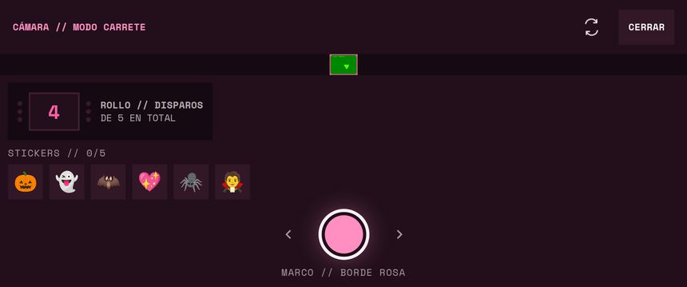
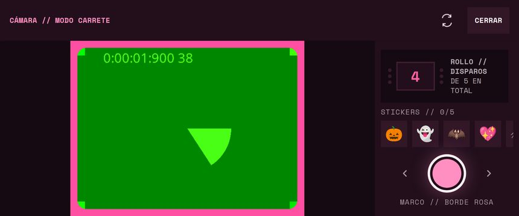

# Informe de la revisión móvil (épica A)

Fecha: 2026-10-23 y 24. Rama `fix/revision-movil`. Backlog de origen: [`backlog-diseno-y-marcos.md`](./backlog-diseno-y-marcos.md), épica A. Estado de la app: [`estado-del-producto.md`](./estado-del-producto.md).

## En una frase
La app del invitado estaba sana en tamaños táctiles pero tenía un bloqueante probable (zoom de iOS en la inscripción); el panel de la organizadora tenía el trabajo pendiente: pestañas apiladas, una lista de avisos rota a 360 px, botones de 25–32 px y texto de 10–11 px. La cámara en horizontal era inutilizable. Todo eso está arreglado y medido; **nada de esto se probó en un teléfono real** (ver «Qué no se probó»).

## Cómo se probó
Los scripts están en [`scripts/qa-movil/`](../../scripts/qa-movil/README.md) para repetir la revisión antes de la fiesta o tras un cambio de diseño.

- **Navegadores:** WebKit de Playwright con el perfil iPhone 13 (390×664 útiles), Chromium con Pixel 7 (412×839), Chromium a 360×640, y los dos teléfonos en horizontal (iPhone 750×342, Pixel 863×360). WebKit de Playwright en Linux no es Safari de iOS.
- **Datos:** Supabase simulado con `page.route` (evento «NOCHE DE DISFRACES» con el estilo Rosa chicle, 12 invitados, 24 fotos, 3 avisos, 3 marcos y 6 stickers). Nada salió a producción ni se crearon datos reales.
- **Pantallas:** 22 por perfil (10 del invitado y 12 del panel, con las 9 pestañas, la moderación y el escáner), en 5 perfiles: 110 combinaciones por corrida.
- **Qué se midió en cada una:** desborde horizontal real (contra el ancho esperado del perfil, porque Chromium móvil agranda el viewport si el contenido es más ancho), tamaño de fuente de los campos, objetivos táctiles menores de 44 px (para casillas se mide su etiqueta), texto menor de 12 px, capas `fixed` a pantalla completa y errores de JavaScript. Además, capturas revisadas a ojo.
- **La cámara real** solo se probó con la cámara falsa de Chromium. WebKit de Playwright no tiene cámara, así que allí solo se ve el estado «Cámara no disponible».

## Resultados (antes → después)

| Medida | Antes | Después |
|---|---|---|
| Campos de texto de menos de 16 px (zoom de iOS) | 8 en la inscripción y 2–5 en cada pestaña con formularios | **0** |
| Desborde horizontal de la página | 1 pantalla: Avisos del panel (página de 405 px en una pantalla de 360; +2 px en Pixel) | **0** |
| Textos de menos de 12 px | más de 500 nodos en 20 pantallas | **0** |
| Elementos táctiles de menos de 44 px (iPhone 13) | 259 en 12 pantallas | **0** (la corrida completa dejó 7, corregidos después y re-medidos a 360 px) |
| Errores de JavaScript en los recorridos | 0 | 0 |

Los números «antes» salen de la primera corrida; la pantalla del escáner y el visor de fotos no se abrieron bien en ella (el selector era incorrecto) y se corrigieron en la siguiente.

## Hallazgos y arreglos

| Gravedad | Hallazgo | Arreglo |
|---|---|---|
| Bloqueante (probable) | Campos a 14 px: Safari de iPhone amplía la página al enfocarlos y no vuelve solo. Afecta al formulario de inscripción. | Regla en `globals.css` solo para pantallas táctiles (`pointer: coarse`): campos a 16 px. En el computador siguen a 14 px. Verificado en el navegador: 8 de 8 campos a 16 px. |
| Bloqueante | **Avisos del panel a 360 px:** los botones Despublicar, Editar y Eliminar se salían del borde y el título quedaba en una columna de 2 palabras. | Contenido y acciones se apilan en pantalla angosta y desde `sm` vuelven a ir en fila; el texto se parte (`min-w-0`, `break-words`). |
| Bloqueante | **Cámara en horizontal:** el visor quedaba en un recuadro de unos 40 px de alto. | Variante `short` de Tailwind (horizontal y de menos de 500 px de alto): visor a la izquierda y controles en una columna a la derecha. |
| Alto | Las 9 pestañas del panel se apilaban en 3 filas de 36 px. | `PanelTabs`: una fila con scroll horizontal, 44 px, la activa se lleva a la vista (instantáneo con movimiento reducido). |
| Alto | Botones de 25–32 px en las listas (Aprobar, Quitar, Restablecer acceso, Editar, Eliminar…). | Regla global para pantallas táctiles: todo `button` mide al menos 44 px (salida: `data-compact`). Ajustes puntuales en enlaces, resúmenes, interruptores y emojis. |
| Alto | Texto de 10–11 px en 289 lugares. | Todo a `text-xs` (12 px). Un test falla si vuelve a aparecer texto fijo menor de 12 px. |
| Medio | `min-h-screen` usa `100vh`, que en iOS es la altura con la barra del navegador escondida. | `min-h-app`: `100vh` de respaldo y `100dvh`. |
| Medio | Ninguna pantalla respetaba áreas seguras (notch, costados en horizontal, barra de inicio) aunque `viewport-fit=cover` está activo. | `inset-safe` en la cámara, la moderación, el escáner, el visor, el QR de puerta y el aviso del hub. No se puede comprobar sin un iPhone real. |
| Bajo | Copy en voseo en 12 mensajes («Revisá», «Probá», «Intentá», «Creá», «Tocá», «cerrá»…); la app habla de «tú». | Corregido; un test vigila 56 formas acentuadas del voseo en todo `src` (`.ts` y `.tsx`). |

Tres capturas del panel a 360 px, antes y después:

| Avisos | Invitados | Cámara |
|---|---|---|
|  |  |  |
|  |  |  |

La cámara del invitado en horizontal, antes y después:

Otras pantallas, ya con los arreglos: [inscripción en iPhone](./revision-movil/inscripcion-iphone.jpg), [cartelera en iPhone](./revision-movil/cartelera-iphone.jpg), [cámara en Pixel](./revision-movil/camara-pixel-vertical.jpg), [moderación en horizontal](./revision-movil/moderacion-horizontal.jpg).

## Lo que sigue pendiente
- **Título del documento:** todas las pantallas del invitado muestran «Inscríbete a la fiesta» como título de la pestaña, también dentro del evento. Es de baja prioridad.
- **Editor de capas (`LayerProperties`) y editor de marcos (`FrameEditor`):** conservan filas de 20 px en sus interruptores, y sus muestras de color miden 32 px (marcadas `data-compact`, sobre el mínimo de 24 px de WCAG 2.2 AA). No se rediseñaron porque la épica B decide qué pasa con ellos. Estas dos pantallas no entraron en el recorrido automático.
- **`PostsPanel` y `/admin`** vienen de la Fase 0: se arregló el diseño que rompía en el teléfono, no su estética.
- **El panel de 9 pestañas** sigue siendo largo para usarlo durante la fiesta; la épica D lo reordena.
- **Peso de la página:** no se midió. El paquete principal pasa de 500 kB y las fuentes de Google se piden siempre.
- **Pantalla de revisión de la foto** (después de disparar) no se recorrió en horizontal.
- **Solo se probó el estilo Rosa chicle.** Los otros tres presets pasan el contraste por test, pero no se revisaron a ojo.

## Qué no se probó
- Ningún teléfono real. Safari de iOS, el navegador interno de WhatsApp o Instagram, ni Chrome de Android.
- Que la sesión del invitado sobreviva al abrir el enlace desde la cámara del teléfono al escanear el QR.
- Los permisos de la cámara, el flash y el rendimiento del lienzo al componer el marco.
- Las áreas seguras (`env(safe-area-inset-*)` vale 0 en los simuladores).
- La subida real de fotos y la carga de imágenes reales: las fotos de la prueba son dibujos SVG.
- El zoom de Safari en sí: en el simulador se comprueba el tamaño de la fuente, no el zoom.

## Lista para probar en tu teléfono (5 minutos)
1. Abre el enlace del evento en Safari: toca el campo «Nombre y apellido». La página **no** debe agrandarse.
2. Inscríbete, activa la cámara con el QR y saca una foto con un marco.
3. Gira el teléfono con la cámara abierta: el visor debe verse grande y los controles quedar a la derecha.
4. Desde WhatsApp, abre el enlace del evento y revisa que entre sin pedir inscribirse otra vez.
5. En el panel, recorre las 9 pestañas deslizando; en Avisos, revisa que los botones no se salgan.
6. Revisa que el obturador y los botones de abajo no queden tapados por la barra inferior.
